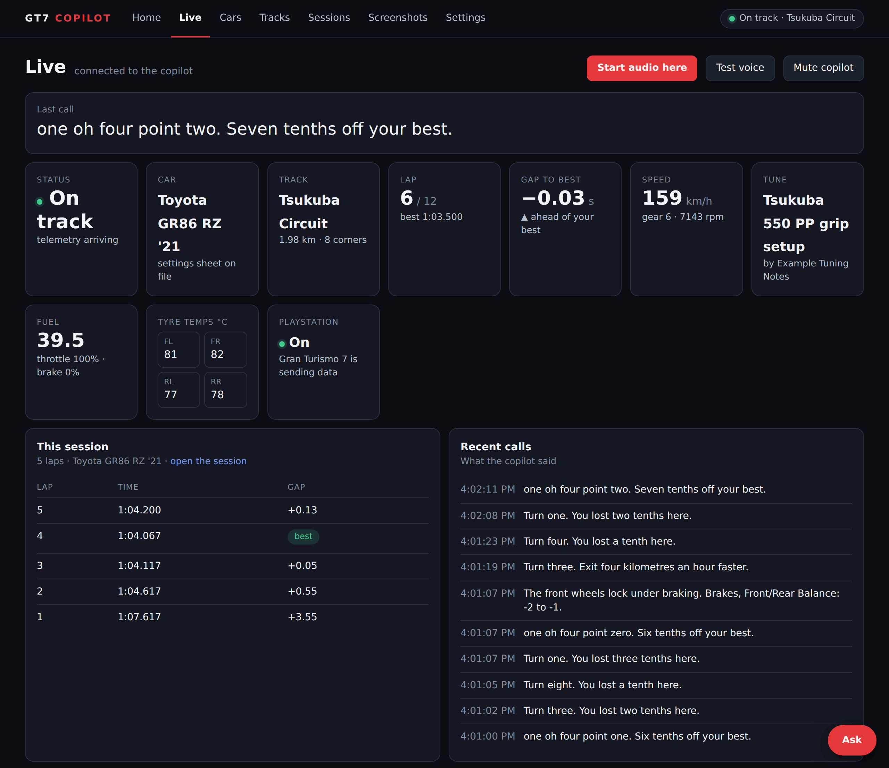
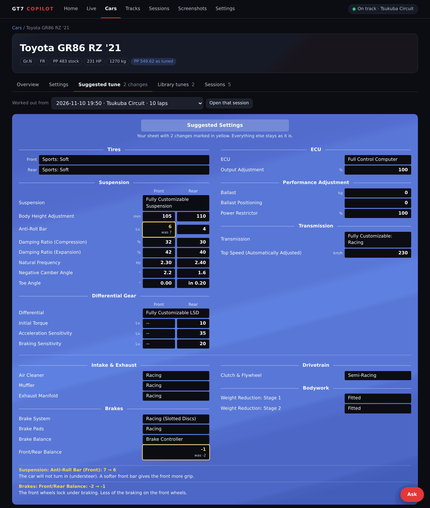
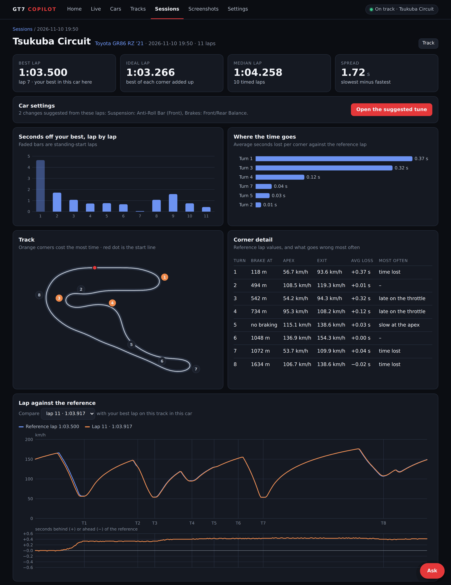
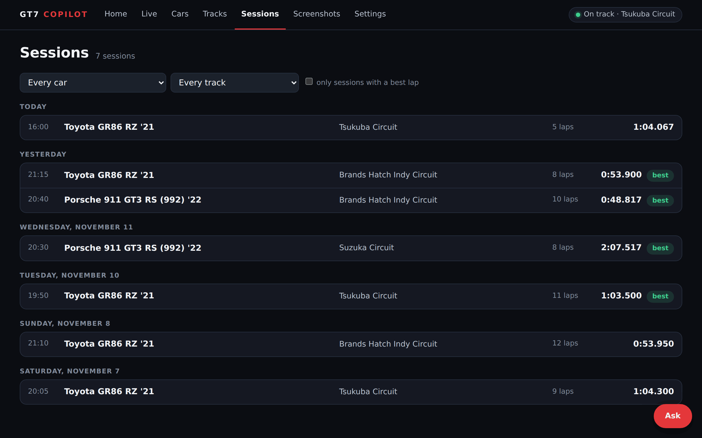
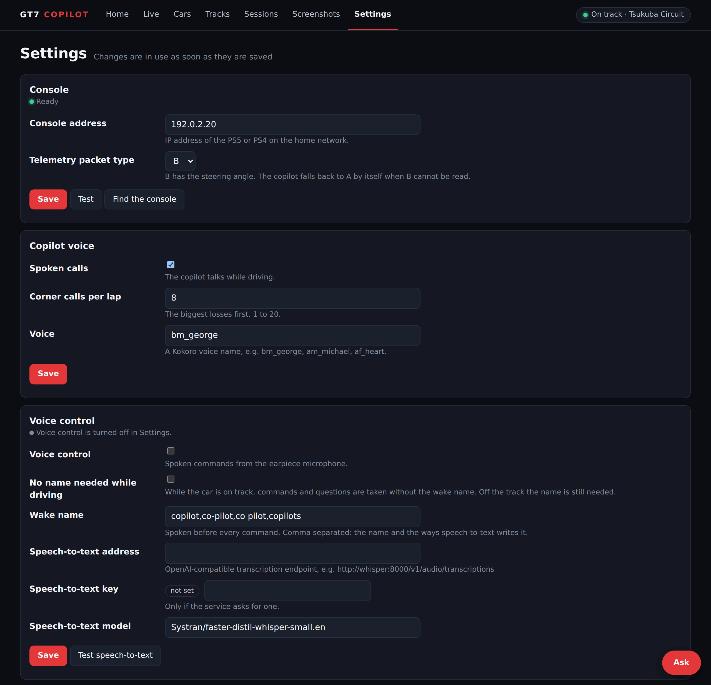
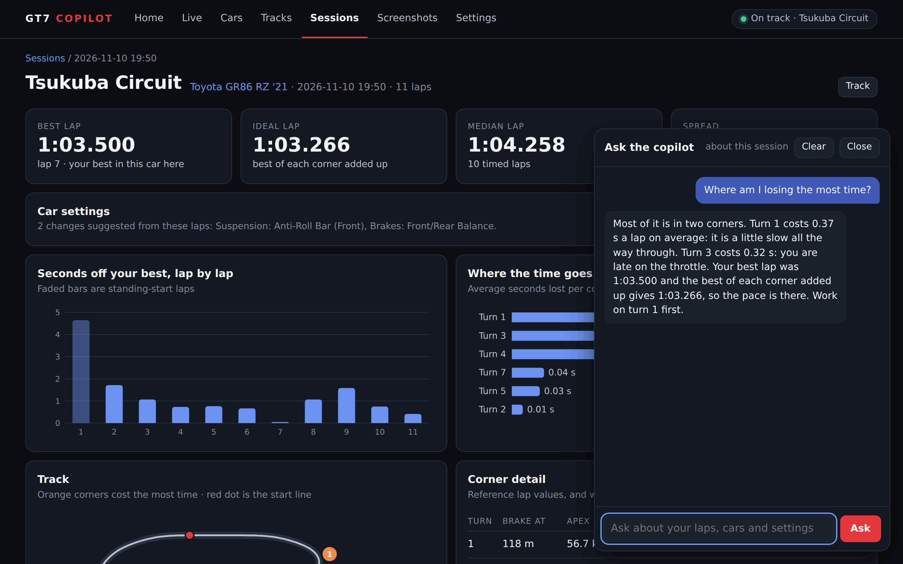
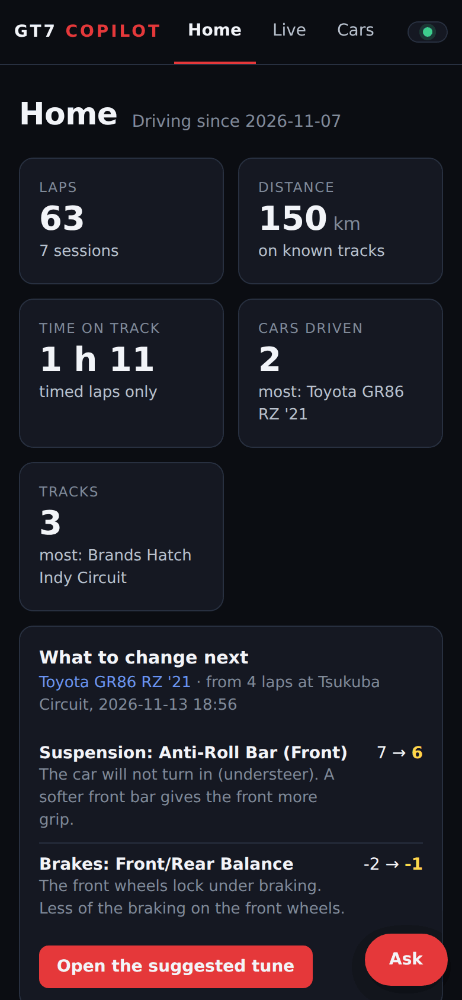
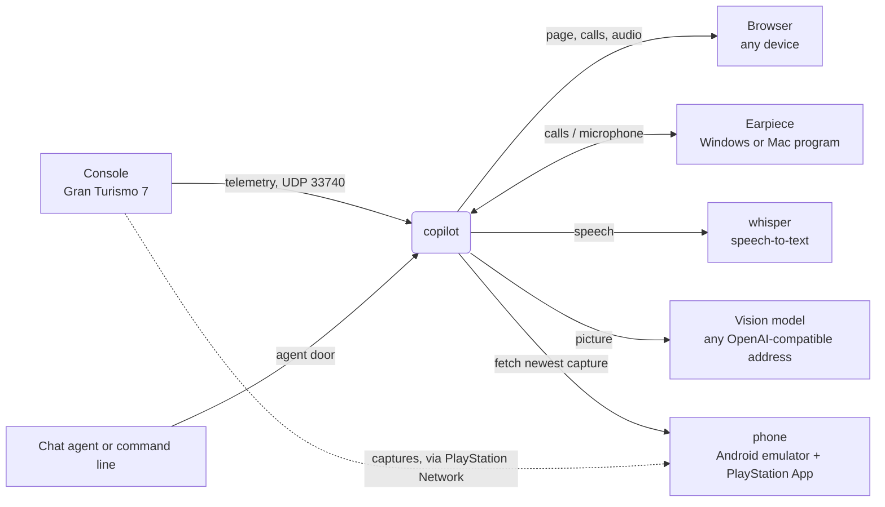

# GT7 Copilot

GT7 Copilot is a self-hosted companion for Gran Turismo 7. It does four things:

- **Spoken feedback while driving.** It reads the telemetry the game sends over the home network and calls out
  where time was lost, lap times, fuel and tyre temperatures.
- **Conversation while driving.** The driver can talk to the copilot in plain sentences and ask about the car,
  the laps, fuel and settings.
- **Lap analysis.** It records every lap and shows where time was lost, corner by corner.
- **Car tuning from a screenshot.** It reads the car's settings from a picture of the game's Car Settings
  screen and suggests which settings to change, based on how the driver's own laps went in that car.

Gran Turismo 7 reports a lap time without showing where the time was gained or lost, and it gives no guidance
on car setup. GT7 Copilot fills that gap using data the game already provides.

It runs as one container on the home network. Nothing is installed on the console, and it needs no account or
cloud service.



The pictures on this page show simulated demo data.

An independent project, with no affiliation to or endorsement by Sony Interactive Entertainment or Polyphony
Digital. See [Trademarks and credits](#trademarks-and-credits).

## Contents

- [Car tuning from a screenshot](#car-tuning-from-a-screenshot)
- [While driving](#while-driving)
- [Talking to the copilot](#talking-to-the-copilot)
- [After a session](#after-a-session)
- [Pictures](#pictures)
- [What it needs](#what-it-needs)
- [Quick start](#quick-start)
- [Try it without a PlayStation](#try-it-without-a-playstation)
- [The parts](#the-parts)
- [Optional parts](#optional-parts)
- [Settings](#settings)
- [Limits](#limits)
- [Security](#security)
- [Development](#development)
- [Trademarks and credits](#trademarks-and-credits)

## Car tuning from a screenshot

The game's telemetry does not include the car's settings, so the copilot reads them from a picture.

1. **Take a picture of the Car Settings screen.** A PS5 screenshot or a phone photo of the television both work.
   It can be uploaded on the page, shared from the PlayStation App on Android, sent by an iPhone Shortcut,
   dropped in a watched folder, or fetched automatically by the optional virtual phone.
2. **A vision model reads the screen.** Tyres, suspension, differential, aerodynamics, ECU, ballast,
   transmission, brake balance and fitted parts are read into a settings sheet. Every value is then checked
   against what the game allows, and anything outside that range is refused.
3. **Drive.** The copilot records how the car behaves in the driver's hands over the timed laps of a session:
   wheelspin, lock-ups, understeer and oversteer on corner entry and exit, tyre temperatures.
4. **It suggests a tune for that driver.** The suggestions come from those laps, so they fit how that driver
   drives the car. The sheet is shown laid out like the game's own Car Settings screen, with each suggested
   change marked and the reason given, for example "The front wheels lock under braking. Brakes, Front/Rear
   Balance: -2 to -1." One change is proposed at a time.
5. **It tracks the result.** After a change is made, the copilot pairs it with what the following laps did,
   and keeps a library of tunes for each car.

The vision model is any model at an OpenAI-compatible address, local (Ollama, vLLM) or hosted. The suggestions
are worked out by rules from the telemetry and the sheet. Reading screenshots is an optional part; a sheet can
also be filed by an agent or from the command line. Details in [docs/screenshots.md](docs/screenshots.md).



## While driving

- **Corner feedback.** Before a corner where time was lost on the previous lap, it says what to do differently.
  After the corner, it reports the result, for example "Turn one. You lost two tenths here."
- **Lap times.** At the line it reads the lap time and the gap to the best lap.
- **Fuel and pit stops.** Fuel remaining, laps of fuel left and a countdown to the pit lap.
- **Tyres.** A warning when tyre temperatures leave their working range.
- **Race summary.** A short summary at the end of a race.

The calls are produced by rules from the driver's own laps, and the voice is generated locally (Kokoro).

## Talking to the copilot

The driver can speak to the copilot through the earpiece microphone and get a spoken answer.

- **Plain sentences.** "How is the fuel?", "Is the fuel going to last?", "Where am I losing time?", "What
  should I set the rear differential at?", "Is the rear too soft?" A language model works out what the
  sentence means.
- **No wake word on track.** While the car is on track the name "Copilot" can be left out. Off the track the
  name is needed, so talk in the room is ignored.
- **Answers from the driver's own data.** Fuel, lap times, settings and pit plans are answered with the app's
  own figures. Open questions are answered by the model in a sentence or two.
- **It remembers what it is told.** "I will pit on lap eight", "I'm staying lean" or "it's raining" are noted
  for the session, and the fuel and pit calls follow.
- **What it cannot see.** Weather, other cars, positions and tyre wear are outside the telemetry. When asked
  about them, the copilot says so.

This is an optional part. It needs the earpiece program, a speech-to-text service (the stack can run one) and a
chat model at any OpenAI-compatible address, local or hosted. With the chat model off, a short list of fixed
commands still works. Details in [docs/voice.md](docs/voice.md).

## After a session

- **Lap analysis.** Lap times, time lost per corner with the most frequent cause, and the speed trace of any
  lap against the reference lap, on a map of the track.
- **Ask (optional).** Questions in plain words ("what should I change next?"), answered from the recorded laps,
  settings and tuning notes.
- **History.** Every session, lap, car and track is kept. Tracks are recognised by their outline from a set of
  85 known layouts; a track outside the set is named once by hand or from a screenshot.



## Pictures

All from simulated demo data (`tools/demo`), with the simulated car on track.

| | |
|---|---|
| [](docs/images/sessions.png) Every session, by day, with its best lap. | [](docs/images/settings.png) The Settings tab. Keys are never shown. |
| [](docs/images/ask.png) Ask, on a session page. The answer in this picture comes from a stand-in for the model. | [](docs/images/phone.png) The Home page on a phone. |

## What it needs

- A PS5 or PS4 running Gran Turismo 7, on the same network as the machine that runs the copilot.
- Docker with the compose plugin. Any machine that can run a small container; the voice model needs about 1 GB of memory.
- UDP port 33740 open from the console to that machine. See [docs/console.md](docs/console.md).
- For the optional virtual phone only: Docker must be able to make an IPv6 network. See [docs/phone.md](docs/phone.md).

## Quick start

```sh
git clone https://github.com/quinneydavid/gt7-copilot
cd gt7-copilot
docker compose up -d
```

Then:

1. Open `http://<machine>:8765`.
2. Open the Settings tab and choose an admin password.
3. Enter the console's address under Console, press Test with the game on track, then Save.
4. Go to the Live page, press "Start audio here" and drive.

No file needs editing. Everything else is on the Settings tab.

## Try it without a PlayStation

A simulated car drives laps of a known layout and sends the same telemetry packets a console sends. It needs Python with `numpy` and `pycryptodome` on any machine that can reach the copilot:

```sh
python3 tools/demo/sim.py --to <machine> --fast-laps 2       # ten laps of Tsukuba; --list shows the other layouts
```

Open the Live page and the car is on track; the laps are recorded like real ones. The Live page still asks for a console address until one is saved in Settings: the address of the machine that runs the simulator will do. The driving is made up, so start with an empty data volume or remove it afterwards (`docker compose down -v` deletes everything recorded).

## The parts



Only `copilot` is required.

## Optional parts

| Part | What it adds | What it needs | Where |
|---|---|---|---|
| Voice control | Spoken commands through the earpiece microphone | A speech-to-text service. The `voice` profile of the stack runs one on the CPU. | [docs/voice.md](docs/voice.md) |
| Screenshot reading | Settings and event screens read from a picture: uploaded on the page, shared from an Android phone, sent by an iPhone Shortcut, dropped in a watched folder, or handed in by an agent | A vision model at any OpenAI-compatible address (Ollama, vLLM, a hosted API) | [docs/screenshots.md](docs/screenshots.md) |
| Ask | A chat on every page: questions in plain words ("what should I change next?", "where am I losing time?"), answered from your own laps, settings and the filed tuning guides | A chat model at any OpenAI-compatible address (the one that reads screenshots will do). The app works out the facts; the model only puts them into words | [docs/ask.md](docs/ask.md) |
| Virtual phone | Fetches the newest PS5 capture by itself, so no picture has to be uploaded | The `phone` profile: x86-64 Linux with `/dev/kvm`, about 9 GB of memory, a PlayStation Network sign-in | [docs/phone.md](docs/phone.md) |
| Earpiece | Plays the calls into one audio device without a browser, and sends the microphone | Windows 10 or 11, or a Mac (the Mac version is not yet tested on a real Mac) | [docs/earpiece.md](docs/earpiece.md) |
| Agent door | A chat agent or a command line on another machine reads laps and files sheets and tunes | An agent that can run commands or make HTTP requests | [docs/agent.md](docs/agent.md) |

To run the optional containers, set the profiles once and start the stack again:

```sh
cp .env.example .env       # then uncomment COMPOSE_PROFILES=phone,voice
docker compose up -d
```

Each part is still off until it is switched on in Settings. A part that is off says so wherever it is asked for: on the page, in the voice, on the command line and to an agent.

## Settings

All settings are on the Settings tab and are stored in the data volume (`settings.json`, readable by the container's user only). They apply at once, without a restart.

- The first visit sets an admin password (or `GT7C_ADMIN_PASSWORD` gives one from the start, see below). Changing settings needs it. The driving pages need no password.
- Keys and tokens can be set, replaced and cleared, but are never shown again. A token made by the copilot is shown once.
- Each group has a Test button that asks the service a small question and reports the answer.

Environment variables named `GT7C_...` are read only as the value of a setting that has never been saved. A few are not settings and are read at every start, because they must exist before the page opens:

| Variable | Meaning |
|---|---|
| `GT7C_DATA` | The data folder. In the image: `/data`. |
| `GT7C_PORT` | The page's port inside the container. Default 8765. |
| `GT7C_ADMIN_PASSWORD` | The admin password until one is saved on the Settings tab. Without it, the first visitor to the Settings tab chooses the password; with it, nobody on the network can get there first. See [SECURITY.md](SECURITY.md). |
| `GT7C_TRUST_DOOR` | `1` = a sign-in already stands in front of the whole page. See below. |

`GT7C_TRUST_DOOR=1` is for an installation that already has a sign-in in front of the whole page (single sign-on, a proxy with a login): the copilot then asks for no admin password of its own. Do not set it when the page is open on the network.

## Limits

- The telemetry has no tyre wear, no tyre compound, no track name and no settings sheet. The track is told from where the car drives (85 known layouts); the sheet comes from a screenshot, an agent or the command line.
- Camber, toe and downforce cannot be measured from telemetry. They appear only as "suspect settings" when a sheet is on file.
- Advice needs three timed laps. The thresholds behind the calls come from a small number of real sessions and may need tuning.
- The vision model can misread small icons. The direction of toe is the known weak spot; a sheet with a value outside the game's limits is not filed.
- The virtual phone drives the PlayStation App by its on-screen labels and, in one place, by screen position. An app update can break it. See [docs/phone.md](docs/phone.md), also for what this means under the PlayStation Network terms.

## Security

The driving pages have no login. The copilot belongs on the home network or behind a reverse proxy with its own sign-in. Details in [SECURITY.md](SECURITY.md).

## Development

```sh
python3 -m venv .venv && .venv/bin/pip install numpy pycryptodome
for t in tests/test_*.py; do .venv/bin/python "$t" || break; done
```

The tests drive a simulated car (`tests/sim.py`) and need neither a console nor the voice model. `tools/probe.py --ps5 <address>` prints raw telemetry. `tools/refresh_carspecs.py` rebuilds the car tables after a game update; `tools/build_knowledge.py` rebuilds the tuning datapoints.

The pictures in `docs/images` are made from simulated data. To take them again after the page has changed (about three minutes; UDP port 33740 must be free on the machine):

```sh
.venv/bin/pip install playwright pillow && .venv/bin/playwright install chromium
.venv/bin/python tools/demo/shots.py
```

`tools/demo/make_demo.py <folder>` only fills a new data folder with the demo sessions, to look around in.

## Trademarks and credits

"Gran Turismo" and "PlayStation" are trademarks of Sony Interactive Entertainment Inc. Gran Turismo 7 is developed by Polyphony Digital Inc. This project is not affiliated with, endorsed by or supported by either company. It uses the telemetry that the game sends on the local network and does not modify the game or the console.

- Car and manufacturer names and stock performance points: [ddm999/gt7info](https://github.com/ddm999/gt7info) (MIT No Attribution).
- Track outlines used to name a track from where the car drives (`data/circuits.json`): the circuit inventory of [zetetos/gt-telemetry](https://github.com/zetetos/gt-telemetry) (MIT, © 2024 vwhitteron).
- Car specifications: the official car list on gran-turismo.com.
- Tuning datapoints in `data/knowledge.json`: short statements in this project's own words, each with a link to its source (Coach Dave Academy, DG Edge, Traxion).
- Voice: the [Kokoro](https://huggingface.co/hexgrad/Kokoro-82M) model (Apache-2.0) through [kokoro-onnx](https://github.com/thewh1teagle/kokoro-onnx), downloaded when the image is built.
- The telemetry packet format was worked out by the Gran Turismo community.

The licence texts and what the container image contains are in [THIRD-PARTY-NOTICES.md](THIRD-PARTY-NOTICES.md).

Licence: [MIT](LICENSE).
